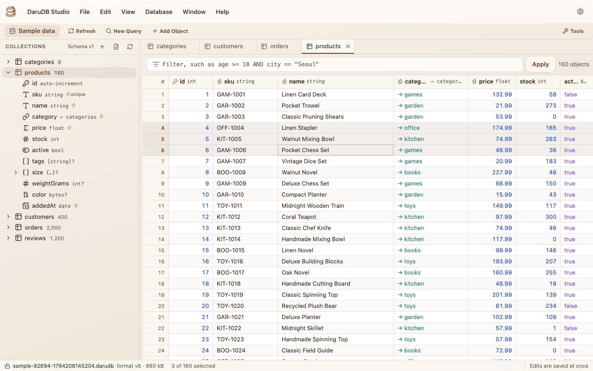
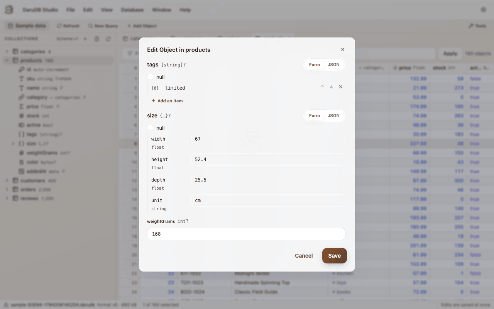
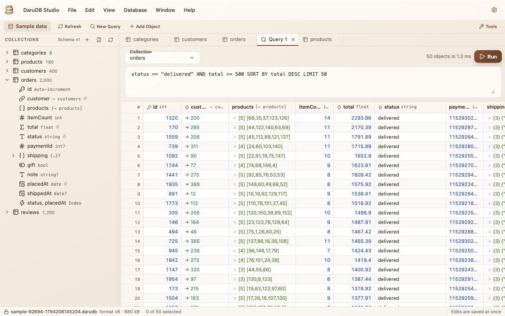
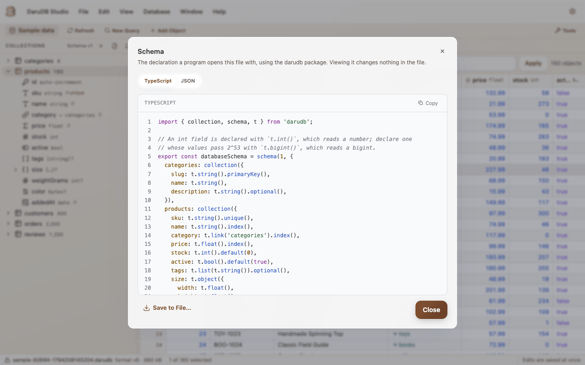
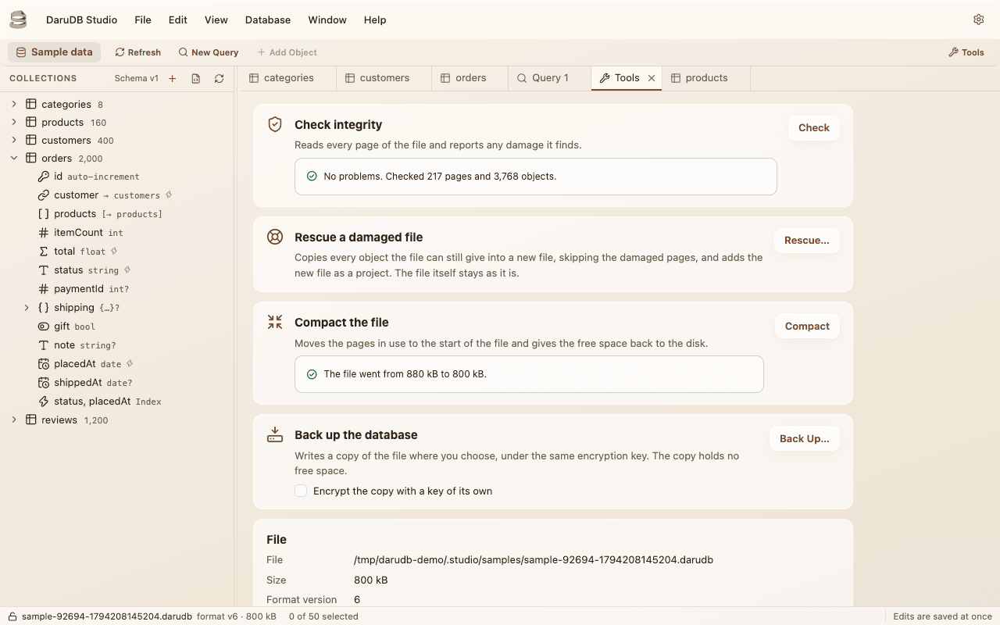
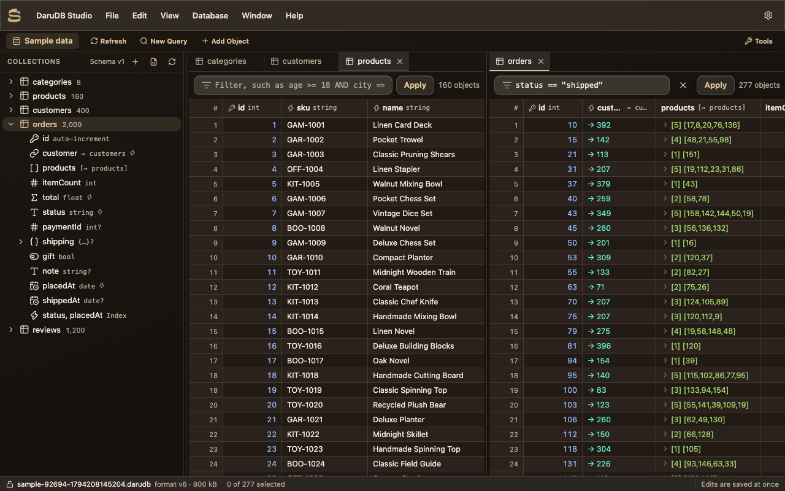

# DaruDB Studio

DaruDB Studio is a desktop app for Windows, macOS and Linux that opens a DaruDB file and shows its collections, objects and schema, and lets you change them without writing a program to do it.

The app reads the schema from the file itself, so it opens a file whichever language wrote it. It reads and writes through the Node.js package, which is the same engine every package uses, so what it shows is what your program reads.

## Download

The installers are on the [Releases page](https://github.com/jooy2/darudb-studio/releases) of the [`darudb-studio` repository](https://github.com/jooy2/darudb-studio).

| System  | What to download                                                                |
| ------- | ------------------------------------------------------------------------------- |
| Windows | The installer (`.exe`), the portable app, a `.zip`, or the `.appx` package, x64 |
| macOS   | The `.dmg` for Apple silicon, for Intel, or the universal one for both          |
| Linux   | The `.deb`, `.rpm` or `.snap` package, x64                                      |

The source is in the same repository, under the MIT license, and bug reports and feature requests go to its [issues](https://github.com/jooy2/darudb-studio/issues).

## Open a file

The app keeps each file you open as a project: a name for the file, where it is, and, if you ask, its encryption key, which the operating system's keystore keeps encrypted. A file of any extension can be picked, and the app checks that it is a DaruDB database before keeping it.

- An encrypted file asks for its key when the project remembers none, or when the one it remembers no longer opens the file.
- A file in an older format version is opened on a copy the app raises to the current version, or raised in place, as you choose. [Format versions](../engine/file-format.md#format-versions) says what raising a file means.
- The project list also opens a sample database of a small shop, with every kind of field in it, to try the app on without a file of your own. Each sample is a new file in the app's own folder, deleted when the app quits.

## Browse and edit objects

Each collection opens in a tab, as a grid that reads its objects a page at a time, so a large collection scrolls as fast as a small one. Columns sort and resize, the filter above the grid takes the [query language](./query-language.md), and values are colored by type. Lists and embedded objects expand in place, and a link shows the key of the object it points to.

A field of one value is edited in its cell, as in a spreadsheet. The whole object is edited in a dialog, where a list or an embedded object is a form of its items and fields, or JSON, whichever is easier for the change. A date is shown and typed as RFC 3339 text in UTC.

An edit is written to the file as soon as you make it, or held until you submit every held edit from the toolbar, as the settings say. Held edits can be discarded until then.

## Run queries

A query tab runs a query written whole in the query language, `SORT BY` and `LIMIT` included, and shows the objects it finds in a grid that edits them as a collection's tab does.

The `Database` menu exports what a tab shows, or only its selected rows, to CSV or JSON, and imports objects from either into a collection, adding them or replacing the objects with the same key. An import is written in one transaction, so a file with one object that does not fit the collection imports nothing.

## The schema

The sidebar lists the collections in the file, with how many objects each holds, and under each its key, its fields and their types, and its indexes. The schema opens in a dialog as the TypeScript the Node.js package declares it with, or as JSON, to copy into a program or save to a file.

Collections and their fields are added, renamed and deleted from the sidebar. Each change is a migration the engine runs, and it raises the schema version stored in the file by one, with a backup of the file first if you ask for one.

::: warning A program that declares the old version stops opening the file

After a schema change in the app, the file's schema version is newer than the one your program declares, and opening it fails with `SCHEMA_TOO_NEW`. Declare the new version, and the same collections and fields, in the program before it opens the file again. [Several versions at once](./migrations.md#several-versions-at-once) has the rule.

:::

## Tools

The tools tab does what the [tools](./tools.md) of the packages do, on the open file: it checks its integrity, compacts it, and writes a backup, encrypted with a key of its own if you ask. It also changes the key of an encrypted file.

A damaged file is rescued into a new file that holds every object it can still give, which the app adds as a project of its own. The rescue is offered in the tools tab, and when a file fails to open because of the damage. The damaged file itself stays as it is.

## Tabs, windows and themes

Tabs split into groups side by side, move between them and merge again. Each window opens one project, and starting the app again opens another window in the app already running. When the settings ask, the app opens the windows, projects and tabs it had open when it last quit.

The app is in English, German, French, Japanese and Korean, with a light and a dark theme. Both follow the system until the settings pick one.
