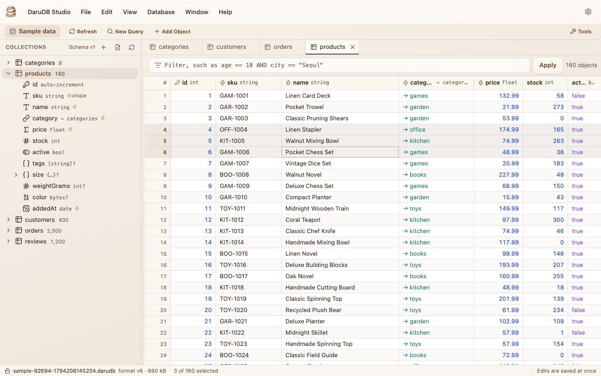
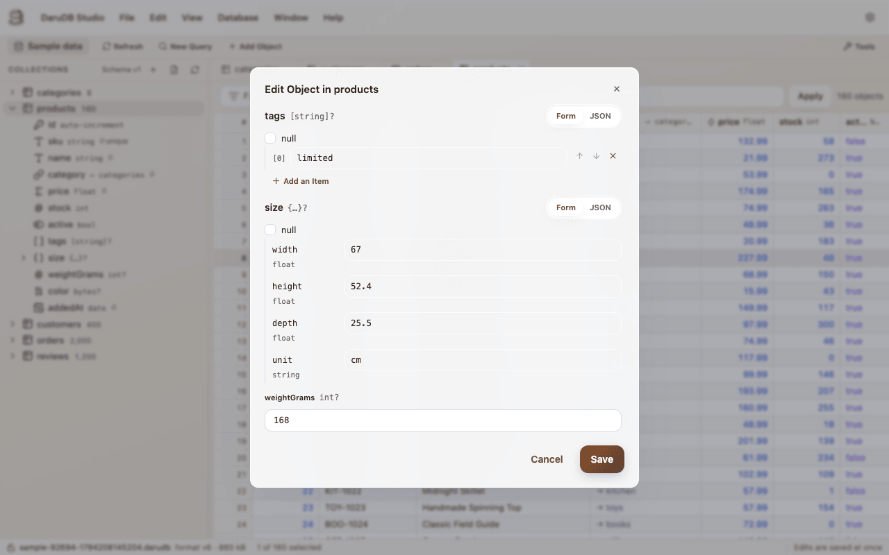
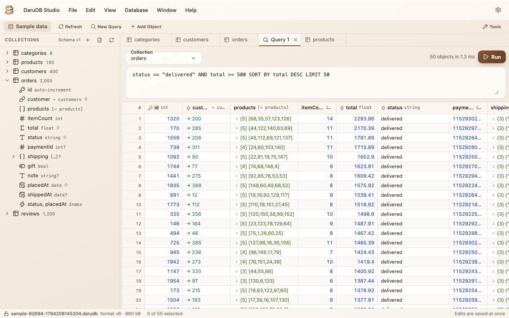
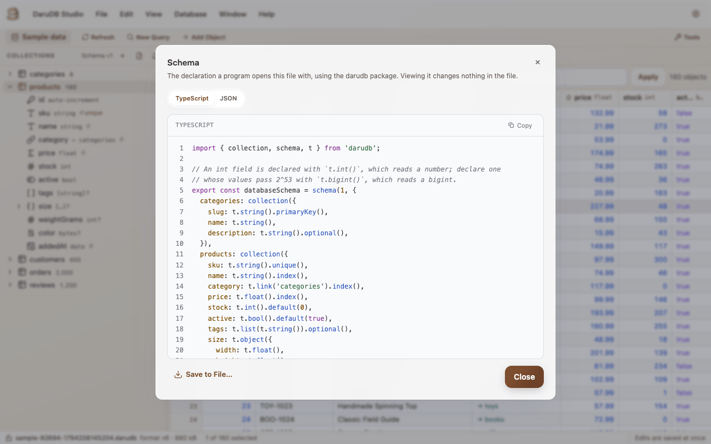
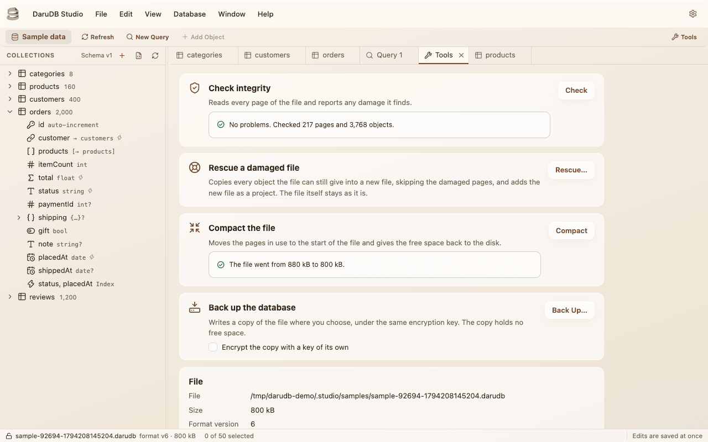
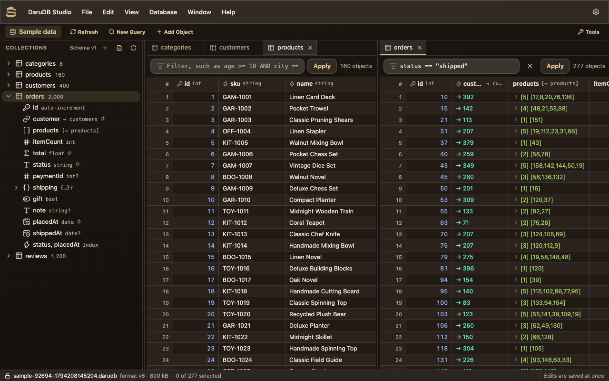

# DaruDB Studio

DaruDB Studio는 DaruDB 파일을 열어 컬렉션과 객체, 스키마를 보여 주는 Windows, macOS, Linux용 데스크톱 앱으로, 프로그램을 따로 짜지 않아도 파일 속 데이터를 고칠 수 있습니다.

앱은 스키마를 파일에서 직접 읽습니다. 그래서 어느 언어로 쓴 파일이든 엽니다. 파일을 읽고 쓸 때는 Node.js 패키지를 거치는데, 이 패키지도 다른 패키지와 같은 엔진을 쓰므로 앱에 보이는 내용이 곧 여러분의 프로그램이 읽는 내용입니다.

## 내려받기

설치 파일은 [`darudb-studio` 저장소](https://github.com/jooy2/darudb-studio)의 [Releases 페이지](https://github.com/jooy2/darudb-studio/releases)에 있습니다.

| 운영체제 | 받을 파일                                                             |
| -------- | --------------------------------------------------------------------- |
| Windows  | 설치 프로그램(`.exe`), 포터블 앱, `.zip`, `.appx` 패키지 중 하나(x64) |
| macOS    | Apple 실리콘용, Intel용, 둘 다에서 도는 유니버설 `.dmg` 중 하나       |
| Linux    | `.deb`, `.rpm`, `.snap` 패키지 중 하나(x64)                           |

소스 코드도 같은 저장소에 MIT 라이선스로 공개돼 있습니다. 버그 제보와 기능 제안은 저장소의 [이슈](https://github.com/jooy2/darudb-studio/issues)에 남겨 주세요.

## 파일 열기

앱은 연 파일을 프로젝트로 기억합니다. 프로젝트에는 파일의 이름과 위치가 담기고, 원하면 암호화 키도 담깁니다. 키는 운영체제의 키 저장소가 암호화해 보관합니다. 확장자와 상관없이 어떤 파일이든 고를 수 있고, 앱은 DaruDB 데이터베이스인지 확인한 다음에 프로젝트로 남깁니다.

- 암호화된 파일은 프로젝트에 기억된 키가 없거나, 기억된 키로 더는 열리지 않을 때 키를 묻습니다.
- 예전 형식 버전의 파일은 앱이 사본을 만들어 현재 버전으로 올린 뒤 열거나, 원본을 그 자리에서 올립니다. 어느 쪽인지는 직접 고릅니다. 파일을 올린다는 게 무슨 뜻인지는 [형식 버전](../engine/file-format.md#형식-버전)에 있습니다.
- 프로젝트 목록에서 작은 쇼핑몰의 샘플 데이터베이스도 열 수 있습니다. 모든 종류의 필드가 들어 있어서 내 파일 없이 앱을 둘러보기 좋습니다. 샘플은 열 때마다 앱 폴더에 새 파일로 만들어지고, 앱을 끄면 지워집니다.

## 객체 보고 고치기

컬렉션은 탭 하나에 표로 열립니다. 표는 객체를 한 페이지씩 읽어 오기 때문에 컬렉션이 커도 작은 컬렉션만큼 빠르게 스크롤됩니다. 열은 정렬하고 너비를 바꿀 수 있고, 표 위의 필터에는 [쿼리 언어](./query-language.md)를 그대로 씁니다. 값은 타입마다 색이 다릅니다. 리스트와 내장 객체는 그 자리에서 펼쳐지고, 링크에는 가리키는 객체의 키가 보입니다.

값이 하나인 필드는 스프레드시트처럼 셀에서 바로 고칩니다. 객체 전체는 대화상자에서 고치는데, 리스트나 내장 객체는 항목과 필드로 된 폼으로 고쳐도 되고 JSON으로 고쳐도 됩니다. 날짜는 UTC 기준 RFC 3339 텍스트로 보이고, 같은 형식으로 입력합니다.

고친 내용은 설정에 따라 바로 파일에 쓰이거나, 도구 모음에서 제출할 때까지 모아 둡니다. 모아 둔 변경은 제출하기 전까지 버릴 수 있습니다.

## 쿼리 실행하기

쿼리 탭에서는 `SORT BY`와 `LIMIT`까지 포함한 쿼리 언어 문장을 통째로 실행합니다. 찾은 객체는 표로 나오고, 이 표에서도 컬렉션 탭과 똑같이 객체를 고칠 수 있습니다.

`Database` 메뉴는 탭에 보이는 객체나 선택한 행만 CSV나 JSON으로 내보내고, 두 형식의 파일에서 객체를 컬렉션으로 가져옵니다. 가져올 때는 새로 추가하거나, 키가 같은 객체를 바꿔 씁니다. 가져오기는 트랜잭션 하나로 쓰기 때문에, 컬렉션에 맞지 않는 객체가 하나라도 있으면 아무것도 들어가지 않습니다.

## 스키마

사이드바에는 파일에 있는 컬렉션이 객체 수와 함께 나오고, 컬렉션마다 키와 필드, 필드의 타입, 인덱스가 나옵니다. 스키마 대화상자는 Node.js 패키지로 이 스키마를 선언하는 TypeScript 코드나 JSON을 보여 줍니다. 프로그램에 복사해 넣거나 파일로 저장할 수 있습니다.

컬렉션과 필드는 사이드바에서 추가하고, 이름을 바꾸고, 지웁니다. 바꿀 때마다 엔진이 마이그레이션을 실행해 파일에 저장된 스키마 버전을 하나 올립니다. 원하면 바꾸기 전에 파일을 백업합니다.

::: warning 예전 버전을 선언한 프로그램은 파일을 열지 못합니다

앱에서 스키마를 바꾸면 파일의 스키마 버전이 프로그램이 선언한 버전보다 높아지고, 프로그램이 파일을 열 때 `SCHEMA_TOO_NEW`로 실패합니다. 파일을 다시 열기 전에 프로그램에서도 새 버전과 같은 컬렉션, 필드를 선언하세요. 규칙은 [여러 버전을 한 번에](./migrations.md#여러-버전을-한-번에)에 있습니다.

:::

## 도구

도구 탭에서는 패키지의 [도구](./tools.md)가 하는 일을 열린 파일에 그대로 합니다. 무결성을 검사하고, 파일을 압축하고, 백업을 씁니다. 백업은 원하면 별도 암호화 키로 암호화합니다. 암호화된 파일이라면 키도 바꿀 수 있습니다.

손상된 파일은 아직 읽을 수 있는 객체를 모두 새 파일로 옮겨 복구하고, 앱은 그 파일을 새 프로젝트로 추가합니다. 복구는 도구 탭에서 할 수 있고, 손상 때문에 파일이 열리지 않을 때도 앱이 먼저 권합니다. 손상된 원본 파일은 건드리지 않습니다.

## 탭, 창, 테마

탭은 그룹으로 나눠 나란히 놓고, 그룹 사이로 옮기고, 다시 합칠 수 있습니다. 창 하나에는 프로젝트 하나가 열리고, 앱을 한 번 더 실행하면 이미 실행 중인 앱에 창이 하나 더 열립니다. 설정에서 켜 두면 마지막으로 앱을 끌 때 열려 있던 창과 프로젝트, 탭을 다음 실행 때 다시 엽니다.

앱은 영어, 독일어, 프랑스어, 일본어, 한국어로 쓸 수 있고, 밝은 테마와 어두운 테마가 있습니다. 둘 다 설정에서 고르기 전까지는 운영체제 설정을 따릅니다.
